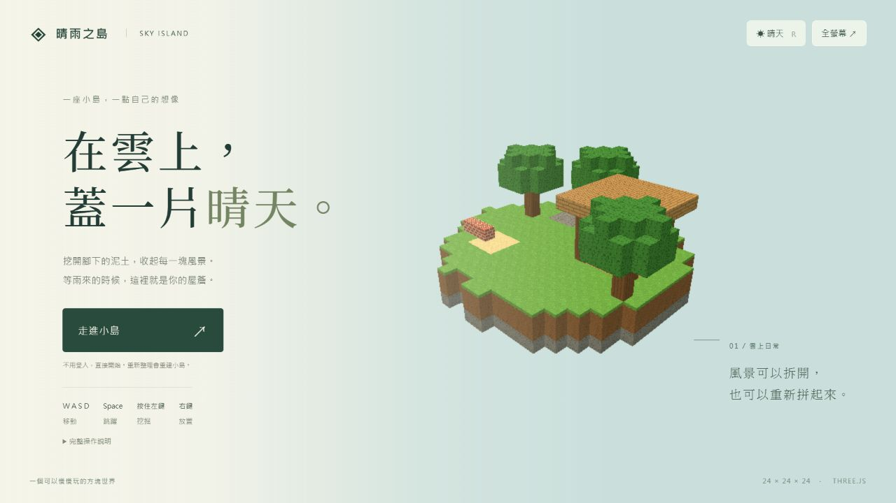

# 晴雨之島

一座可以挖掘、收集與搭建的空中方塊小島。雨來時，走到木棚下避雨；也可以拆掉屋頂，再自己補回去。



## 執行

需要 Node.js 20 以上，不需要安裝任何套件。

```powershell
npm start
```

如果電腦沒有 npm，也可以直接執行：

```powershell
node tools/serve.mjs
```

用瀏覽器開啟終端機顯示的網址，預設為 http://127.0.0.1:4173 。請透過靜態主機開啟，直接雙擊 index.html 會受到瀏覽器的模組載入限制。

`tools/serve.mjs` 只是本機看檔案的小工具。遊戲沒有伺服器程式、帳號或資料庫。`dist/` 可直接放到任何靜態網站主機，執行時不需 CDN 或外部連線。

## 操作

| 操作 | 按鍵 |
| --- | --- |
| 走路 | W、A、S、D |
| 跳躍 | 空白鍵 |
| 看四周 | 滑鼠；無法鎖定時用方向鍵 |
| 挖方塊 | 按住左鍵，或按住 E |
| 撿取 | 走到掉落物旁邊 |
| 放方塊 | 右鍵，或 Q |
| 選取物品 | 1～8、滑鼠滾輪、點物品欄 |
| 晴雨切換 | R，或右上天氣按鈕 |
| 暫停 | Esc、切換視窗、右上暫停按鈕 |
| 全螢幕 | 右上全螢幕按鈕 |
| 效能資訊 | F3 |

重新整理會重建小島，不保存進度。掉出島外會回到安全位置。每種物品最多 64 個，放置距離最多 6 格，無法把方塊放到自己身體裡。

## 測試與過程

```powershell
node --test tests/*.test.js
node tools/check.mjs
node tools/audit-history.mjs
```

共 43 項自動測試，使用遊戲本身的運作邏輯，涵蓋碰撞、挖掘時間、重置、射線、掉落、拾取、放置、物品數量守恆、晴雨與屋頂遮擋。`evidence/step0-red.txt` 到 `step5-green.txt` 保留每一步首次失敗及通過結果；`step5-initial-implementation.txt` 額外保留修正前的一次失敗結果。

`audit-history.mjs` 會核對每步測試提交在實作之前，實作提交未修改測試，且 VERIFY.md 建立後沒有被改動。Git 歷史保留實際提交作者與時間。

## 文件

| 檔案 | 內容 |
| --- | --- |
| BRIEF.md | 功能與限制 |
| VERIFY.md | 老師第 1 批條件與第 2 批驗收項目，留待使用者實際試玩勾選 |
| PLANS.v1.md | 開發前保存的第一版計畫 |
| PLANS.md | 逐步完成紀錄 |
| AGENTS.md | 開發規則 |
| tests/ | 六個步驟的自動測試 |
| evidence/驗證紀錄.md | 實際測試範圍及尚未確認事項 |
| dist/ | 可部署的完整靜態網站 |

## GitHub 繳交

老師要求交 GitHub 儲存庫連結，並檢查開發歷史。請在 GitHub 建立空白儲存庫後，把這個資料夾原本的 Git 歷史推送上去，不要只用網頁上傳檔案，否則會失去先測試再實作的紀錄。

```powershell
git remote add origin 你的GitHub儲存庫網址
git push -u origin main
```

若使用提供的 Git bundle，可先還原完整歷史，再設定 GitHub 遠端：

```powershell
git clone 晴雨之島-history.bundle sky-island
```

## 版本與授權

- three.js 固定為 0.180.0（r180），來自官方 npm 套件庫，MIT 授權保存在 `dist/vendor/THREE-LICENSE.txt`。
- 圖片均來自老師提供的 `sky-island-assets.zip`，沒有重畫、替換或使用其他材質。素材署名與 CC BY-NC-SA 4.0 授權保存在 `dist/assets/LICENSE.txt`。這些素材限本課程作業使用。
- 原始素材雜湊記在 `evidence/assets-sha256.json`，可透過 `check.mjs` 核對。
- 未讀取或複製老師範例遊戲的程式碼。

作業依據：[Week 7 作業說明](https://ai-agent-literacy.pages.dev/weeks/week07/#03-homework-island)、[課程投影片第 29～42 頁](https://docs.google.com/presentation/d/19lQQgUVf6Nb7YAF4vHBsvEVN0AhzHmt5haLbzvNNCXg/htmlpresent)。

效能限制：採合併可見面、剔除內部面、240 滴雨與預設 1 倍畫面比例。開發環境的效能不代表學校舊電腦；仍需到目標電腦以全螢幕實測。軟體 WebGL 的支援與速度由瀏覽器和電腦決定，不保證只有 CPU 的電腦都能達到 30 fps。
